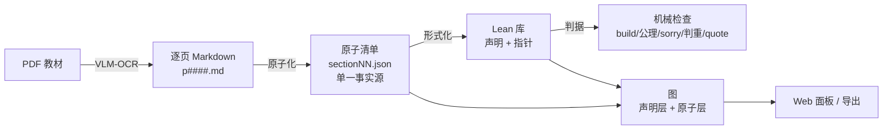

# Project Dusty Archives（项目：故纸堆）

**An agent-driven pipeline that turns a textbook PDF into a mechanically-checked Lean library
and an interactive "atom graph".**
从 PDF 教材到可检查 Lean 库与可视化「原子图」的 Agent 管线。

[](LICENSE)


> 图中已无红虚线框：**G1–G5 全部关闭**。
> G1「书配置 schema」已成文（[book-config.md](docs/book-config.md)：纯数据、人填或提取页码、支持章号≠页序）；
> G2「OCR 可复现性」是本质黑箱（VLM 幻觉只能压低不能消除，改为"视觉核对 + 留痕"规则）；
> G3「多书共存」论证不可行（跨书原子同一性判定不可计算——外延类型论 ETT）；
> G4「插件一般化接口」已成文并已落地 A1–A3（[plugin-api.md](docs/plugin-api.md)：core + book pack；
> 实例已切到 `pipeline-core` + 本书 profile；判据引擎按 `KL_PROFILE` 读 profile，MCP 面只留
> profile 一行 —— core/引擎源码里无书名/书路径硬编码）；A4（第二本书试点）待做；
> G5「评估」不设指标——验收是主观的：**它是否确实还原出了原书的信息**，统计只作辅助证据。

---

## 这是什么

一本数学教材可以被拆成三类东西：

1. **原文**（PDF 扫描件 / 文字层）——人读的东西；
2. **原子**（每个定义 / 定理 / 例子是一条可引用的最小单位）——机器处理的东西；
3. **形式化**（Lean 里可编译、可检查的声明）——机器能验证的东西。

本项目把这三者用一条**全本地、可机械检查**的 agent 管线串起来：



关键设计只有一句话：**「真」只由机械判据决定，agent 负责生成与修复**。
LLM 不直接当裁判——它写转录、写清单、写证明、写图；每一层都有对应的机械检查，
检查不过就修，修不过就停下来报告。

## 文档

| 文档 | 内容 |
|---|---|
| [docs/architecture.md](docs/architecture.md) | **主文档**：从 PDF 到原子图的完整架构（七层、数据契约、判据、agent 协议、插件、一般化） |
| [docs/book-config.md](docs/book-config.md) | **书配置 schema v1**：每节 ↔ 各版本页范围（纯数据，附真实示例与校验清单） |
| [docs/plugin-api.md](docs/plugin-api.md) | **插件接口（G4）**：core + book pack 拆分、book-profile 契约、判据固定/可配/可扩展、迁移与负向测试 |
| [docs/faq.md](docs/faq.md) | 设计取舍 Q&A：为什么这样设计、为什么不那样做 |
| [docs/scenarios.md](docs/scenarios.md) | 除了数学教材，这套方案还能用在哪些场景（附边界说明） |
| [docs/new-book.md](docs/new-book.md) | 换一本书的落地手册（参数清单 + 步骤） |

## 当前状态（活证据）

这套方案不是纸面设计——它已经在一个真实项目上跑通：

| 指标 | 值 |
|---|---|
| 已覆盖教材 | Munkres《Topology》§12–§19（点集拓扑基础部分） |
| 原子 | 131（125 verified + 6 partial） |
| Lean 模块 | 9（Base + 8 节）；§19 单节 70 条声明 |
| 图 | 声明图 + 原子图（367 条原子边），15 条机械断言 |
| 每一节的验收 | 判据（build / sorry&axioms / 基底提及 / 判重 / quote 逐字 / module 卫生）+ 双向覆盖 |
| 插件形态 | 通用 `pipeline-core` + 本书 profile（A1–A3 已落地）；判据引擎按 `KL_PROFILE` 解析书数据，MCP 面（工具/图面板）配置里只留 profile 一行 |

> 注：本仓库只包含**方案文档**与工具接口说明。教材 PDF、OCR 转录与 Lean 源码属于
> 具体实例工程的物料，不随本仓库分发（版权与体量原因）。

## 快速开始（读）

```bash
git clone <this-repo>
open docs/architecture.md     # 先读架构
open docs/faq.md              # 再读取舍
```

## 设计原则（TL;DR）

1. **单一事实源**：每节一个 `sectionNN.json`，图与报告全部由它派生。
2. **原子是一等公民**：建模单位、引用单位、工作单位是同一个「原子」。
3. **指针而非复制**：Lean 侧只存 `(模块, 位置, 签名哈希)`，不复制源码。
4. **判据唯一实现**：所有"真"只在一个检查器里，禁止 grep/临时脚本代替。
5. **agent 有分工有证据**：Lead 裁决、worker 按原子施工、每步贴工具使用证据；
   遇到问题立刻停，不硬扛。
6. **基底透明性**：借来的世界（mathlib）的内部结构不影响产物的结构——
   允许借用范围从"本书要自造的概念在 mathlib 的对应声明"反向推导，随书生成。

## License

[MIT](LICENSE)。文档与代码同样以 MIT 分发；书中原文版权归原作者/出版社所有。
