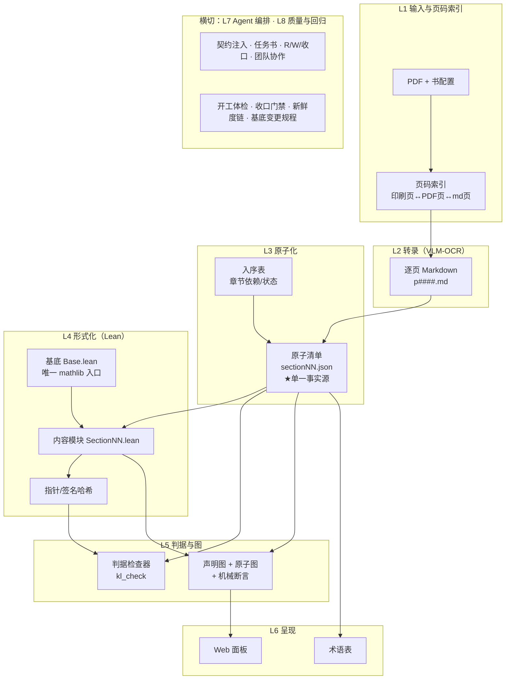
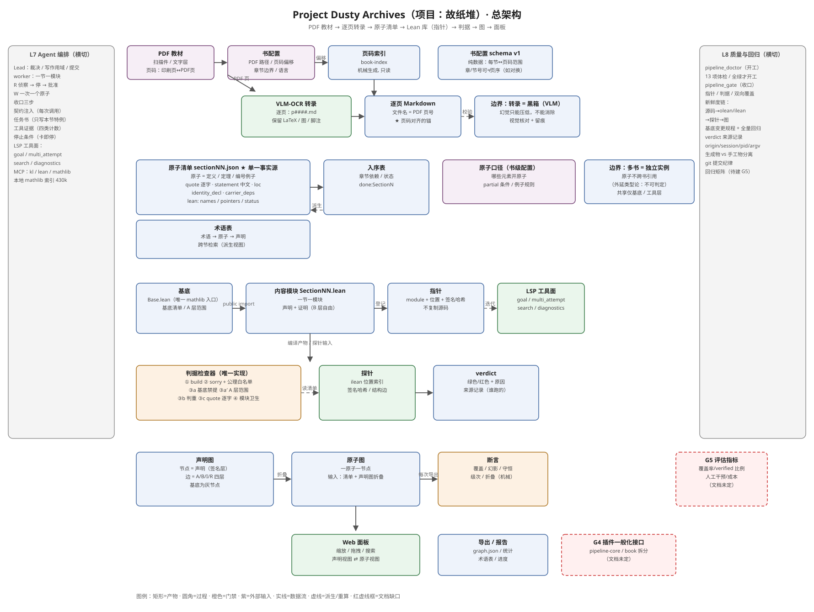
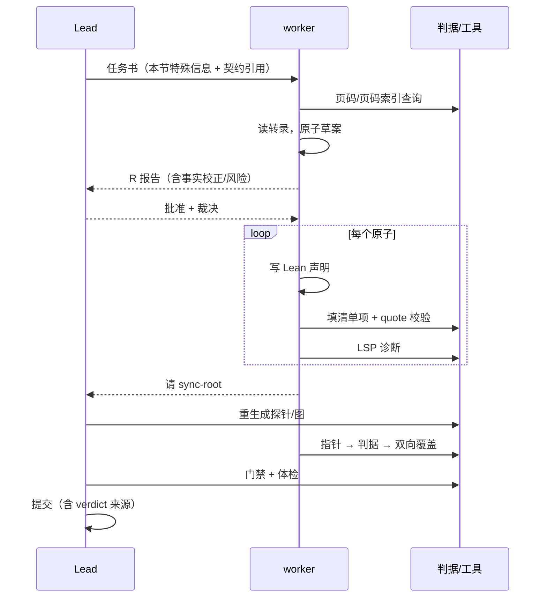

# 架构：从 PDF 到原子图

> **状态**：v1 架构稿（2026-10-25；2026-10-27 补 §4.2 三件套、按意图重写判据）。本文只写架构：各层职责、接口、数据流、扩展点、
> 以及「为什么」。具体机制参数（判据公式、命令、环境变量）属于实例工程文档，不在本仓库；
> 每条判据的**意图 / 数据源 / 「不抓什么」**以实例工程 `docs/工程基准.md` §4 为准。
> 标注约定：**[通用]** = 方案本体；**[实例]** = 当前唯一完整实例（Munkres《Topology》§12–§20）的具体参数。

---

## 0. 摘要与设计原则

本方案把一本教材转成三个可独立引用的产物：

```
原始 PDF
  └─(1) VLM-OCR 转录─►  逐页 Markdown（保住版面/公式/图）
        └─(2) 原子化─►  原子清单（每定义/定理/例子 = 一条原子，单一事实源）
              ├─(3) 形式化─► Lean 库（每个原子有指向声明的指针）
              ├─(4) 判据──►  机械"真"值（编译/公理/sorry/内容概念禁提/陈述层范围/判重/引文可溯源/模块卫生）
              └─(5) 构图───►  声明图（四层边）+ 原子图（一原子一节点）─► 面板/导出
```

六条设计原则，后文所有取舍都由此推出：

| # | 原则 | 含义 |
|---|---|---|
| 1 | **单一事实源** | 每一节只有一个清单文件；图、报告、术语表全部由它派生，不手写第二份 |
| 2 | **原子是一等公民** | 「原子」同时是**建模单位**（图上一点）、**引用单位**（清单一行）、**工作单位**（agent 一次只做一个） |
| 3 | **指针而非复制** | 对 Lean 只存 `(模块, 位置, 签名哈希)`；对文本（quote）才存原文，因为文本没有稳定锚 |
| 4 | **判据唯一实现** | 所有"真"只在一个检查器里；grep、临时脚本、模型自述都不算判据 |
| 5 | **agent 有分工、有证据、会停** | Lead 裁决边界，worker 按原子施工；工具使用必须给可核对的证据；卡住立刻停 |
| 6 | **基底透明性** | **借来的世界（mathlib）的内部结构，不影响原书实现产物的结构**：允许借用的范围从"这本书要自造的概念在 mathlib 的对应声明"反向推导，而不是按 import 闭包或全库可用 |

---

## 1. 问题定义

### 1.1 形式化问题

- **输入**：一本有页码的数学教材 PDF（扫描件或文字层均可），以及书的元信息
  （书名、版次、语言、页码映射）。
- **中间产物**：
  - 逐页 Markdown 转录（一页一个文件，文件名即页码）；
  - 每节一个**原子清单**（定义/定理/例子 → 原子 + 原文 quote + 中文 statement）。
- **输出**：
  1. 一个 `lake build` 通过的 Lean 库：每个原子有 `verified`（可证）或 `partial`
     （书只证一部分/代价过高，附 witness）的声明指针；
  2. 一张图：声明层（谁引用了谁，四种边）与原子层（一原子一节点，可读）；
  3. 派生物：术语表、章节依赖/进度表、回归数据。

### 1.2 非目标

- **不是**"全自动形式化"：方案接受人的裁决（哪些例子开原子、哪些定理降 partial、
  哪些引用进基底）。
- **不是**通用 OCR 产品：VLM-OCR 只要求"忠实转录并可与页码机械对齐"。
- **不绑定具体数学领域**：当前实例是点集拓扑，但原子口径与判据是领域无关的配置。

### 1.3 为什么必须是 agent 而不是传统脚本

脚本能做的只有确定性步骤（页码索引、建目录、跑判据）。真正的工作——
"读原文判断这句话是不是一个定理"、"把定理写成 Lean 能接受的形式"、
"证明失败时判断是定理写错还是引理缺失"——需要**带工具的模型**反复行动。
所以本方案的骨架是：

```
确定性的交给脚本（判据、生成物、重算）
非确定性的交给 agent（理解、写作、修复），但 agent 的每一步都被判据约束
```

---

## 2. 总体架构

七层，数据自左向右流动，质量门禁横切。



**层间只通过文件与判据耦合**：L2 不知道 L4 存在；L4 只读 L3 的清单；L5 只读
L3+L4 的产物。任何一层都可以单独替换（换 OCR 模型、换 Lean 版本、换渲染器）。

### 2.1 总图（含文档缺口标记）



图由 `tools/make_architecture_svg.py` 生成（SVG 可编辑、可版本化；改图即改脚本）。
图例：矩形=产物 · 圆角=过程 · 橙色=门禁 · 紫=外部输入 · 实线=数据流 · 虚线=派生/重算 ·
红虚线框=**文档缺口**。

### 2.2 从总图读出的缺口（G1–G5）

这张图除了描述现状，也用来暴露"哪里还没写清楚"。目前 **0 个红框（G1–G5 已全部关闭）**：

**已关闭：G5 评估——没有指标体系，验收是主观的。**
最终验收标准只有一条：**它是否确实还原出了原书的信息**——这是人读输出后的主观判断，
不是可量化分数。不设"覆盖率 ≥x / verified 比例 ≥y"这类指标：单实例样本下指标没有统计意义，
而且一旦设指标，"讨好指标"就会变成新目标（例如为凑 verified 比例降 partial 口径）。
可提供的是**辅助证据**（不是指标）：原子/quote 命中情况、verified 比例、判据是否全绿、
图数据是否完整——作用是让主观判断有依据、可抽查，不用来打分或做 CI 阈值。
评估方式：case study / 用户验收；发现问题 ⟹ 回到相应层修，判据优先。

**已关闭：G1 书配置 schema（规范已成文）。**
书配置是**纯数据**（"每节对应各版本的哪几页"），不是代码：人拿着两本书的目录填页码，
比让 AI 猜可靠得多。规范见 [book-config.md](book-config.md)：

- 结构：`book_id / title / sources（每源含 path、kind、printed_to_pdf 偏移、md 目录）
  / chapters[] / sections[]（每节给各源的印刷页闭区间）/ boundary_policy / extensions`；
- 顺序规则：章/节数组**按物理装订页序**；章号/节号只是标签，可以不单调
  （已知实例：某英文书 13、14 章装订顺序对换）；
- 只存人能从书上读到的原始数据；md 页、PDF 页区间由偏移机械派生，**不写回配置**；
- 校验清单 V1–V9，关键是 **V5：标题页必须落在本节范围内**、V1/V8：顺序按页不按编号；
- 不规定实现方式：JSON / YAML / CSV 均可，工具只按结构消费。

**已关闭：G4 插件一般化接口。规范已成文，且 A1/A2 已落地实现。**
拆成 **通用 core + 书实例包（book pack）**，core 通过一份 `book-profile.json` 拿到全部
书相关参数。规范见 [plugin-api.md](plugin-api.md)：

- core 负责：判据引擎、门禁流程、agent 协议、数据契约、工具接入（与书无关）；
- book pack 提供：书配置、原子口径、基底参数、领域判据扩展、渲染配置、项目补充契约；
- 判据分三类：**必须固定**（build / sorry+公理 / 内容概念禁提 / 陈述层范围 / 判重 / 引文可溯源 / 模块卫生）、
  **可配参数**（基底候选、禁提清单、extras、lib 名等）、**可加扩展**（只读、幂等、命名空间、
  失败即红）；结构上没有"关闭核心判据"的 API；
- 迁移路径 A1–A4 + 负向测试（缺 profile 字段拒绝启动、扩展异常即红、无法关闭核心判据）。

> **实现进度（2026-10-25）**：A1（core 从 profile 读）+ A2（本书 pack）+ A3（引擎与 MCP 面
> 全部 profile 驱动）已完成 —— 插件 `@local/dsh-pipeline-core` + 实例 pack
> （`knowledge/book-profile.json` + `docs/契约补充.md`）；core 源码里 grep 不到书名/书路径，
> 判据引擎按 `KL_PROFILE` 解析书数据（60 处书硬编码已替换），MCP 面只留 profile 一行。
> 同一份 core/引擎用 profile 跑出与旧 Munkres 专用实现**相同**的 gate/doctor 输出。
> 只剩 A4（第二本书试点）—— 那是"换书只写 pack"的最终验收。

**已关闭：G3 多书共存布局（论证为不可行，不是"待补"）。**
跨书引用要求判定"两本书里的两条陈述是不是同一个原子"——这等价于判定两段数学内容的
同一性，而数学同一性本质上是等价关系（定义展开、命题等价、证明无关），判定它需要
"两段陈述/两个类型是否相等"的判定；**外延类型论（ETT，extensional type theory）的
相等判定/类型检查不可判定**（equality reflection），所以这在计算机上做不了。
因此设计规则是：

- **一本书 = 一个独立实例**，原子不跨书引用；
- 多本书之间只在**基底（mathlib）**与**工具层**共享，不共享原子图；
- 想比较两本书/两个版本的内容，只能做启发式或人工对照，不能承诺机械等价判定。

**已关闭：G2 "OCR 可复现性"（本质是黑箱，不是"待补"）。**
"视觉信息 → 携带语义的 LaTeX"目前**只有 VLM 这一条实用路线**（传统 OCR 拿不到语义，
规则式转换覆盖不了数学版式）；这是个本质上的复杂问题，只能靠黑箱近似解决。
VLM 的幻觉**只能压低、不能根本消除** ⟹ 不存在"逐页重跑结果一致"这种可复现性目标，
验收只能落到**自纠错 + 留痕**上：

- **视觉核对**：关键位置（定义/定理陈述/公式密集处）允许 agent 直接调视觉能力看原书页确认；
- **留痕**：每次视觉核对必须记录（哪一页、确认什么、结论、时间/执行者）；
- **判据放宽只限转录层**：`quote` 判据本身不动（它保证"清单 ↔ md 一致"，不保证"md ↔ 书"）；
  "md ↔ 书"这一段靠视觉核对 + 留痕，允许抽样而不必全页重核，但**必须留下记录**。

> 注：G1/G4 是"规范补上就关闭"；G2/G3 是"本质困难 + 可计算性边界"，靠论证关闭——两种关闭方式不同。
> 文档保留它们，是为了阻止后来者重复论证同一个不可能问题；同时把可做的事（视觉核对、留痕、
> 抽样）写成规则。

> 处理方式：每补一个框，就把该框从图里删掉，并在对应章节写下接口与失败模式——
> 图与文档同步演进；完成标准不是"写完了"，而是"框消失了"。


---

## 3. 各层职责与接口

### 3.1 L1 输入与页码索引

**职责**：把"书上说的第 x 页"变成"机器可定位的位置"。

- **书配置**（规范： [book-config.md](book-config.md)）：纯数据——`book_id/title`、
  若干 `sources`（PDF 路径、类型、印刷页→PDF 偏移、md 目录）、可选 `chapters[]`、
  `sections[]`（每节给各源的**印刷页闭区间**）、边界策略。人填目录页码即可，派生值不落盘。
  **顺序规则**：`chapters`/`sections` 按**物理页序**排列，章号/节号只是标签，**不要求单调**
  （已知实例：某英文书 13、14 章装订顺序对换）；实现禁止假设"编号递增 ⟹ 页码递增"。
- **页码索引**：由书配置机械生成，之后**只读**；支持条目级定位（"Lemma 13.4 在第几页"）。
- 硬规则：**禁止凭记忆引用页码**，所有引用必须来自索引。

**接口**：`book.md(p) ↔ 印刷页 p ↔ PDF 页 p+偏移`；每节五坐标（中译印刷/PDF、英译印刷/PDF、md 页）。

**失败模式**：边界页归属错（一章的最后一页同时属于下一节）、扫描件无文字层、版本漂移。

### 3.2 L2 转录：VLM-OCR

**职责**：PDF 页 → 忠实 Markdown，保住数学公式、图表、脚注与行内引用。

- 一页一个文件（`p####.md`，#### = PDF 页号），**文件名即页码**，这是后续所有页码对齐的基础。
- 保留 LaTeX 原样（OCR 不"翻译"、不"简化"）；图用机械解码（矢量/位图检测）而不是肉眼读。
- 质量锚：转录页范围必须覆盖该节标题页与首个定义页；页码索引与 md 标题机械对账。
- **本质边界（G2）**："视觉 → 语义 LaTeX"目前只有 VLM 能做，幻觉只能压低不能消除；
  不存在"可复现的逐页重跑"目标。正确做法不是追求零幻觉，而是：
  1. **关键位置视觉核对**：定义/定理陈述/公式密集处，agent 可直接调视觉能力看原书页确认；
  2. **留痕**：核对必须记录（页、确认内容、结论、时间/执行者），
     建议落在清单 item 的 `vision_checks` 字段（见 §4 数据契约）或独立的转录审计日志；
  3. **判据放宽只限转录层**：`quote` 判据不动（保证"清单 ↔ md"），"md ↔ 书"靠视觉核对 +
     留痕；允许抽样而非全页重核，但**不能没有记录**。
- 中译扫描件只能到节级定位；复杂版式仍需人工抽检（这一类属于"留痕里的抽样比例"问题）。

**接口**：`read(md_page) → 文本`；`quote` 校验 = 规范化后必须是该页区间内的连续子串。

### 3.3 L3 原子化（方案核心抽象）

**原子** = 原文里一个可独立引用、可独立判断真假的单位：一个定义、一条定理、
一个例子（口径由书配置决定）。原子清单是整条管线的**唯一事实源**。

每个原子至少包含：

| 字段 | 用途 |
|---|---|
| `id` / `kind` | 稳定编号 + 类别（definition/theorem/example/…） |
| `quote` | 原文片段（判据：规范化后必须能在对应 md 页里找到；「逐字」是俗称） |
| `book_ref` / `loc` | 书上的编号/位置（用于人读与页码核对） |
| `statement` | 中文转述（人读、教学、检索用；不是判据） |
| `identity_decl` | "书上说法 ↔ Lean 里的什么" 的翻译说明（编码选择/符号差异） |
| `carrier_deps` | 该原子依赖的其它原子/载体 |
| `lean` | 指针：`names / primary / derived / witness / pointers[{module,pos,sig_sha256}] / status` |

**两种引用，两种存法**：

- **quote 存文本**：Markdown 转录没有稳定锚（页会随版本/重排漂），而且判据本身就是
  "逐字连续子串"，所以存原文是唯一可机械验证的形态。
- **Lean 存指针**：`(module, 位置, 签名哈希)` 三件套。位置和类型都能重算，指针只是快照；
  源码一改，`--check` 立刻报「位置过期/签名变了」。

**接口**：每节一个 `sectionNN.json`；章节间的计划与进度在 `入序表`（每项有依赖与状态）。

**失败模式**：quote 边界拍到邻页、把说明性段落当例子、partial 滥用。

### 3.4 L4 形式化：Lean 库

**职责**：把原子写成 Lean 声明，并让"书—原子—声明"三者可互相定位。

- **三层边界**：
  - *基底*（borrowed）：从 mathlib 借用的事实，全部收口在唯一的 `Base.lean` 里；
  - *内容*（content）：本库声明的定义/定理；
  - *判据*：见 L5。
- **基底透明性（原则 6 落地）**：允许借用的范围是**从书的内容反向推导**的生成物——
  种子 = 本书要自造的概念在 mathlib 的对应声明，沿**声明级类型引用**传递闭包、扣掉种子本身，
  再并上人工补登记（`scope_extras`）与 core 原语。这样"借来的世界"的内部组织（hub、命名、细分）
  不会塑造我们的库与图的形状。
- **模块系统**：一节一模块，聚合文件是模块表的唯一事实源；模块卫生检查禁止泄漏。
- **A 层（陈述层）引用范围**：签名的类型里只能引用允许集内的名字（判据 ③a′）——
  陈述决定产物结构，所以这里的边界必须机械可查。
- **B 层（证明/定义体）不是"自由引用"**：它只免于 ③a′ 的范围检查；仍受判据 ③a 约束——
  不许出现 mathlib 里那些"我们要自造的实现"（禁止清单对**整个模块**生效）。
  它可以引用 mathlib 的其它引理作为**仪器**（"B 层会多出对 mathlib 的引用，属预期"），
  但这类引用不算基底支撑、不进 `base_candidate`、不塑造产物结构；要新增借用仍走基底变更规程。
- **证明工作循环**：交互式 LSP（看目标 → 试 tactic → 查引理 → 落文件 → 诊断），
  而不是"改文件→编译→看错"的盲试。
- **partial 口径**：书只证一部分、或形式化代价远高于收益时，允许 `partial`：
  0 个 primary + 若干 witness（真正证出来的子命题），仍进图、仍计数。

**指针与新鲜度**：

```
源码 .lean ──lake build──► .olean（环境）+ .ilean（声明位置）
      └──探针──► 签名哈希表（probe）
指针 = (module, .ilean 位置, 签名哈希)
校验 = 位置一致 + 哈希一致 ⟺ 指针未陈旧
```

**失败模式**：`.ilean` 漏记"不提及任何常量"的声明（需源码扫描兜底）、
探针未重跑导致静默错分、模块未进聚合文件。

### 3.5 L5 判据与图

**判据**（唯一的"真"）：

| # | 判据 | 检查什么 |
|---|---|---|
| ① | Build | `lake build` 通过 |
| ② | 无 sorry + 公理白名单 | 全库无未证占位；清单登记声明的公理依赖 ⊆ {propext, Classical.choice, Quot.sound} |
| ③a | 内容概念禁提（禁止清单） | 本节内容模块不得提及禁止清单里的 mathlib 名字（= 本书要自造的概念；基底反而是允许借的） |
| ③a′ | 陈述层引用范围 | A 层（签名）的 mathlib 引用 ⊆ 允许集（反向传播；B 层不查本条） |
| ③b | 判重 | 不许自库内写两遍、不许重造基底已有事实；判定环境 = Base.lean 的 import 闭包 + 本节（不判 mathlib 内容层） |
| ③c | 引文可溯源 | 清单 quote 必须是 md 对应页（规范化后）的连续子串（「逐字」是俗称） |
| ④ | 模块卫生 | 有声明的内容模块必须有 `module` 头 + `@[expose] public section`（否则下游不能展开定义体） |

每条判据只有一个实现；扩展判据 = 改那一个地方 + 跑全库回归。

**图**（L5 的视图）：

- *声明图*：节点 = 声明（签名层），边 = 提及；按签名位置切 A/B 层，结构字段取 I/R 层；
  基底节点为灰色（借用的世界）。
- *原子图*：一原子一节点；声明的边折叠到原子层（primary/derived/witness）。
  这是给人看的图，也是"覆盖率"的可视化。
- *断言*：每次导图都跑机械断言（覆盖/幻影/守恒/级次/折叠…）；断言失败图数据作废。

### 3.6 L6 呈现

- Web 面板：缩放/拖拽/搜索/按模块过滤；声明视图与原子视图可切换。
- 派生物：术语表（跨节检索：术语 → 原子 → 声明）、章节进度/依赖表。
- 原则：**呈现层不产生新事实**，只读图/清单；任何"人读文本"都标注来源。

### 3.7 L7 Agent 编排（区别于脚本流水线的部分）

**角色**

| 角色 | 职责 | 不做什么 |
|---|---|---|
| Lead | 侦察裁决、批准 W、写作用域、收口门禁、提交 | 不亲自写一节的内容（除非救火） |
| section worker | 一节一模块：R 报告 → W 按原子施工 → 收口三步 | 不写别人的文件、不改聚合/入序表 |
| 审计/复核 | 判据复核、回归、图与文档一致性 | 不改内容 |

**三阶段协议**

```
R 只读侦察：页码 → 原子草案（quote/label/statement）→ Lean 声明草案 → 分块/依赖 → 风险
            └─ 汇报并停，等批准（含"任务书事实校正"）
W 施工：以原子为工作单位，一次一个：
        写声明 → 填该原子清单项 → quote 校验 → LSP 诊断 0/0 → 下一个
        └─ 每 1–2 个原子报一次进度 + 工具证据
收口：指针 → 判据 → 双向覆盖 → 图重算 → 回归 → 入序表/术语表 → 提交
```

**契约注入**：流程硬规则（判据/五步/工具优先级/协作/停止条件）写进插件，每次模型调用注入；
任务书只写本节特殊信息（页码、原子草案、裁决、写作用域）。任务书复制规则会漂移。

**证据要求**：agent 必须汇报工具使用情况（如 LSP 的四类调用计数 + 最后一次诊断），
只报"编译通过"不算；判据不认自述，只认产物。

**停止条件**：判据红、quote 失败、证明卡一次、口径歧义、要改别人文件 →
立即停，报告「现象·根因猜测·已试过·需要决定」。

### 3.8 L8 质量与回归

- **两级门禁**：开工前体检（数据新鲜度/环境/入序表状态）→ 收口门禁（指针/判据/双向覆盖）。
- **新鲜度链**：源码 → 编译产物 → 探针 → 图。任一环过期，后续数据静默错误
  （例如 A/B 层分类悄悄漂移），所以每一环都做成可检查项。
- **基底变更规程**：允许 worker 扩展基底，但必须走固定流程 + 已验收节的全量回归。
- **提交纪律**：生成物与手工物分开；verdict 记录来源（谁/哪个入口跑了检查）。

---

## 4. 数据契约（文件即接口）

| 文件 | 性质 | 谁写 | 谁读 | 新鲜度 |
|---|---|---|---|---|
| 书配置（PDF 路径/页码映射） | 手工 | 人 | L1 | 换书时 |
| 页码索引 | 生成物 | 脚本 | L1/L2 | PDF 变则重建 |
| `p####.md` 转录 | 手工/生成 | OCR 管线 | L2/L3 | 页级 |
| `vision_checks`（item 字段 / 转录审计日志） | 手工/生成 | agent（视觉核对时） | 人/L3 | 追加式；核对方为 md 时有效 |
| `sectionNN.json` | **手工（单一事实源）** | worker | L4/L5/L6 | 每节 |
| `入序表.json` | 手工 | Lead | 编排 | 每节 |
| `Base.lean`（借入边界） | 手工 | 人 | L4 / 构建 | 基底变更（走规程） |
| `base_candidate.json`（允许集） | **生成物** | 反向传播探针 | L5 / ③a′ | 允许集要变时重跑 |
| `基底.json`（登记表） | 手工 | 人 | L5（禁区/例外） | 每次借阅或新增内容概念 |
| `.olean/.ilean` | 生成物 | `lake build` | L4 | 源码变 |
| 探针（签名哈希/结构边） | 生成物 | 脚本 | L4/L5 | 源码/ilean 变 |
| `graph.json`（含原子图） | 生成物 | 脚本 | L6 | 探针/清单变 |
| `glossary.json` | 手工+生成 | 脚本/人 | L6 | 每节 |
| verdict（判据结果） | 生成物 | 检查器 | 门禁 | 每次检查 |

规则：**生成物不手改；手工物带来源与时间；schema 变更要迁移 + 全库回归。**

### 4.1 verdict 的生命周期

verdict = 一次完整判据检查的**快照**，写在对应节的清单里（`sectionNN.json.verdict`）。

- **内容**：`at`（时间）+ `by`（`origin/session/cwd/pid/argv`：谁、从哪个入口跑的）+
  各判据结果（build 与耗时、sorry 计数、axioms 检查、禁提命中、quote 逐字结果与逐条 items、
  判重、模块卫生、基底范围违规）+ `problems` + `ok`。
- **谁写**：只有判据检查器（core）写；book pack / 扩展**不能**写 verdict。
- **过期判定**：`verdict.at` 早于源码 / `.ilean` / 探针任一更新时间 ⟹ 视为过期。
- **重跑**：门禁（gate）**总是重跑**，不信任旧 verdict；worker 收口、Lead 复核都会重跑。
  过期 verdict **不得被当作绿**——禁止"上次是绿的"式引用。
- **保留**：清单只存最近一次；历史随 git 保留（verdict 同时是审计材料），不手动删除。

### 4.2 三件套：能看见 / 允许依赖 / 谁批的（2026-10-27 补）

工程里三个名字都带「基底」，但它们是**三条不同的边界**；混用会把判据范围推错
（典型误读：「加一个 import 就能放宽陈述层允许集」——实际不会）。

| 物件 | 是什么 | 谁生成 | `[实例]` 实测 | 消费者 |
|---|---|---|---|---|
| `Base.lean` | **可及边界**（物理）：项目看得见哪些 mathlib 模块 | 人写（import 列表） | 13 条 import → 闭包 **1,253** 个 mathlib 模块 | ① build · LSP/ilean 剪枝 · ③b 判重环境 |
| `base_candidate.json` | **A 层许可集**（语义）：书允许在**陈述**里依赖哪些 mathlib 事实 | 反向传播探针（**不读 `Base.lean`**） | **4,162** 条 | ③a′ 允许集 |
| `基底.json` | **登记表**（裁决）：借阅决策 · 禁区 · 手工例外 | 人写 | `borrowed` 11 · `forbidden_so_far` 14 · `scope_extras` 1 | ③a 禁区 · ③a′ extras · 审计 |

```
可及（能不能写进代码）      ← Base.lean 的 import 闭包
许可（陈述里允不允许依赖）  ← base_candidate ∪ scope_extras ∪ core
禁区（任何层都不许提）      ← 基底.json.forbidden_so_far
```

交叉表（`[实例]` 实测）：

| 可及 | 许可 | A 层（陈述） | B 层（证明/定义体） | 含义 |
|---|---|---|---|---|
| ✓ | ✓ | ✓ | ✓ | **1,884** 条：正常可借 |
| ✓ | ✗ | ✗（判据红） | ✓（「仪器」） | 闭包内其余 ≈68,100 条：证明可用、陈述不许 |
| ✗ | ✓ | ✗ | ✗ | **1,857** 条：休眠许可——要用先走基底变更（把模块 import 进来） |
| ✗ | ✗ | ✗ | ✗ | mathlib 其余 42 万余条 |

禁区覆盖全表：`forbidden_so_far` 里的内容概念，A/B 两层都不许提 mathlib 版本。

**为什么不能合并**：粒度不同（模块级 vs 声明级）；决定者不同（代码事实 / 书 / 人）；
变动条件不同（改 import 不动许可集；重算许可集不改闭包）。

**故障模式**（都是踩过的）：

- 把「许可集」当「可及集」→ 以为 `base_candidate` 里的名字都能引用；实际有 1,857 条连 import 都没进来；
- 把「可及集」当「许可集」→ 以为 B 层能用的引理 A 层也能用；实际 ③a′ 会红；
- 把「登记表」当自动生成 → 新增内容概念忘了写 `forbidden_so_far`；目前**无机械检查**（已知缺口）。

---

## 5. 一般化：从「一本书」到「换一本书」

方案本体与书无关，需要参数化的只有六件事：

| 参数 | 说明 | [实例] 的值 |
|---|---|---|
| 书配置 | PDF、页码映射、语言/版次、章节边界 | Munkres 2nd ed.，英文 PDF 页 −11 = 印刷页 |
| 原子口径 | 什么算一个原子；例子是否开原子；partial 条件 | 定义/定理/编号例子各一原子；说明段不开 |
| 转录口径 | OCR 风格、页码对齐方式 | qwen3-vl，一页一文件，LaTeX 原样 |
| 基底库 | 借用谁的库；A 层允许的名字 | mathlib + Lean 4，`Base.lean` 单入口 |
| Lean 工具链 | 版本、依赖、LSP 配置 | Lean 4.35 + mathlib |
| 呈现配置 | 图的层颜色/标签语言/默认视图 | 中文标签，默认原子视图 |

**插件拆分方向**（接口规范见 [plugin-api.md](plugin-api.md)；✅ = 已实现）：

```
pipeline-core      ✅ 判据/门禁/契约骨架（与书无关；profile 驱动）
pipeline-book-<id> ✅ 书配置/原子口径/基底参数/领域判据扩展/渲染配置/文案
mcp-pipeline       ✅ 一般化的清单/判据/图/页码 API（引擎按 KL_PROFILE 读 profile；工具名保留 kl_*）
graph-panel        ✅ 配置化渲染（读 profile.paths.graph + render 配置）
mcp-lean / mcp-mathlib   ✅ 复用；lean 项目路径显式一行 = profile.paths.repo，mathlib 索引为工具级
```

core 与 book pack 之间只有一份契约：`book-profile.json`（路径/口径/判据参数/扩展清单）。
判据里"必须固定 / 可配参数 / 可加扩展"的分界见 plugin-api.md §4。

**换书手册**见 [new-book.md](new-book.md)。

**多书共存（已论证不可行，非待办）**：跨书引用需要跨书判定原子同一性（"两本书里的两条陈述
是不是同一个"），这等价于判定两段数学内容的同一性；而"两段陈述/类型是否相等"在
**外延类型论（ETT）**里是不可判定的（相等判定/类型检查不可判定）。所以一般化到
"换一本书"为止，不做"多本书合成一张图"：

- 一本书一个独立实例，各自有清单/图/术语表；
- 共享只发生在基底层（同一个 mathlib）与工具层（同一套插件/判据实现）；
- 如果要比较两本书的内容，只能做**启发式/人工**对照，不能承诺机械等价判定。

**原子口径（已定，不需要按书参数化）**："什么算一个原子"沿用默认口径——定义 / 命题 / 例子
三类陈述单元各一原子；联立定义逐个算；例子分图式与实例两种形态；全称命题以书上原命题为准、
不按实例拆；说明性段落不开原子；partial 必须带 witness。实测几乎适用于所有数学读物，
所以 book pack 的 `atoms` 默认就是这套，不鼓励按书改（特殊书覆盖须评审并记录理由）。
细则见实例工程 `docs/工程基准.md §2.1`。

**verdict 生命周期（已定）**：见 §4.1——快照 + 来源戳；过期判定看 mtime；gate 总是重跑；
历史随 git 保留；过期 verdict 不得当绿。

---

## 6. 应用场景

主线是数学教材，但同一套"转录 → 原子 → 形式化 → 图"的结构适用于任何
**有严格陈述、可被形式化、需要引用完整性**的文本。详见 [scenarios.md](scenarios.md)，
包括：其它数学分支教材、计算机科学理论教材、形式化论文/讲义、标准/规范文本、
领域知识图谱、教学与自测题库等。边界也在那里说明（哪些文本不适合）。

---

## 7. 运行环境与容量（[实例]）

- Windows + PowerShell 7；Lean 4.35 + mathlib；Lake 项目。
- LSP 常驻（mathlib 非闭包 `.ilean` 剪枝后 ~0.44 GB）。
- 本地 mathlib 检索索引：SQLite 1.07 GB / 430k 声明；FTS5。
- 图数据：~0.6 MB；全库 A/B 探针秒级。
- agent 侧：一节 W 阶段上下文约 10^5 tokens 量级；压缩阈值 0.65（可调）。

---

## 8. 已知限制与风险

| 层 | 限制 | 现状 |
|---|---|---|
| 转录 | **黑箱**："视觉→语义 LaTeX"只有 VLM 一条实用路线，幻觉只能压低不能消除；无"逐页重跑一致"的可复现性 | 不追求零幻觉：关键位置视觉核对原书 + 留痕（`vision_checks`/审计日志）；`quote` 判据只管"清单↔md"，"md↔书"靠核对+抽样；判据放宽只限转录层 |
| 原子化 | "什么算一个原子"有判断空间 | 口径写进配置 + 逐节抽查 |
| 形式化 | partial 不是全证；mathlib 覆盖不均 | partial 合法但需 witness；缺引理时允许绕过并记录 |
| 编排 | agent 可能"假用工具"、上下文爆 | 证据格式 + 机械判据；原子单位减少单步体量 |
| 工程 | 探针/ilean 类工具盲区 | 每次发现都固化成检查项（doctor） |
| 多书 / 跨书引用 | 原子同一性判定不可计算（外延类型论 ETT）；机械上做不了 | 不做跨书引用：**一书一独立实例**，跨书只共享基底与工具层；版本/译本对比只能启发式 |

---

## 9. 路线图

- **P0（已完成）**：一个完整实例（点集拓扑基础，§12–§20）。
- **P1（差最后一步）**：插件一般化 —— A1/A2/A3 已落地（core + 本书 pack + 引擎/MCP 面
  profile 驱动，见 §2.2）；只剩 **A4**：第二本书最小试点，用来验收「换书只写 pack、代码零改动」。
- **P2**：评估矩阵（覆盖率、verified 比例、人工干预次数、成本）+ 自动回归。
- **P2 补充（基底三件套维护机械化）**：`forbidden_so_far` 与内容层新概念的对应检查；
  `base_candidate` 生成并入 kl（目前跑在外部 mathlib 工程里）。
- **P3**：教学/研究向的图交互与导出。

---

## 附录 A：术语

| 术语 | 含义 |
|---|---|
| 原子 | 书上一个可独立引用的定义/定理/例子；图的节点、清单的行、agent 的工作单位 |
| 借入边界 | `Base.lean` 的 import 闭包：物理上看得见的 mathlib 模块（§4.2） |
| 允许集 | `base_candidate.json`（反向传播生成）∪ `scope_extras` ∪ core：陈述层允许依赖的 mathlib 事实（§4.2） |
| 基底登记表 | `基底.json`：借阅决策（borrowed）/ 禁区（forbidden）/ 手工例外（extras）（§4.2） |
| 基底 / 借用 | 泛称：从 mathlib 借来、不重证的事实集合；具体边界见上三行 |
| 指针 | `(模块, 位置, 签名哈希)`，代替复制 Lean 源码 |
| verified / partial / todo | 原子在 Lean 侧的状态：已证 / 部分证（带 witness） / 未开始 |
| 判据 | 机械检查器；"真"的唯一出处 |
| quote | 清单里逐字的原文片段，覆盖率为"书—原子"对齐提供机械证据 |
| 四层边 | 声明图中 A（签名提及）/ B（证明提及）/ I（结构）/ R（递归）四类边 |
| 原子图 | 一原子一节点的图，由声明图折叠而来 |
| 探针 | 从编译产物提取签名/结构数据的脚本，图与指针的共同输入 |

## 附录 B：一节的生命周期（时序）


