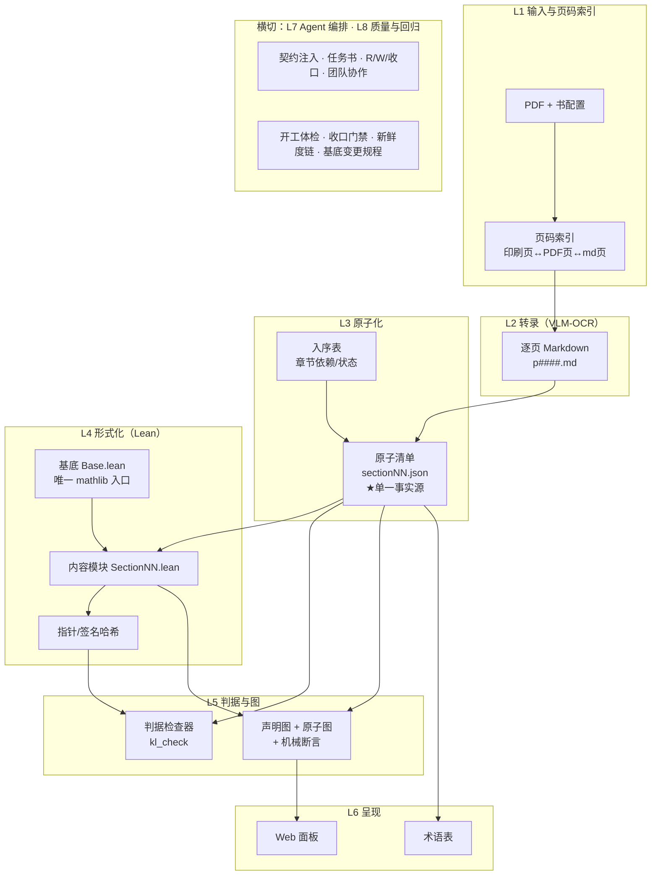
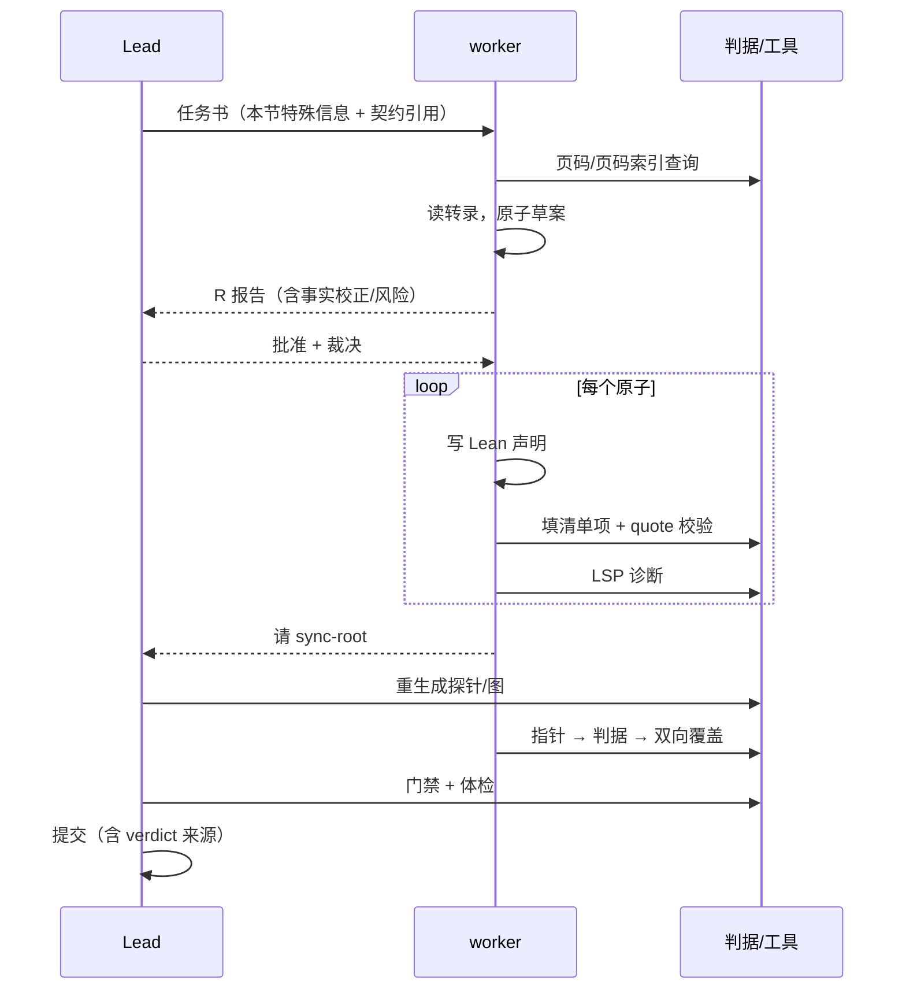

# 架构：从 PDF 到原子图

> **状态**：v1 架构稿（2026-10-25）。本文只写架构：各层职责、接口、数据流、扩展点、
> 以及「为什么」。具体机制参数（判据公式、命令、环境变量）属于实例工程文档，不在本仓库。
> 标注约定：**[通用]** = 方案本体；**[实例]** = 当前唯一完整实例（Munkres《Topology》§12–§19）的具体参数。

---

## 0. 摘要与设计原则

本方案把一本教材转成三个可独立引用的产物：

```
原始 PDF
  └─(1) VLM-OCR 转录─►  逐页 Markdown（保住版面/公式/图）
        └─(2) 原子化─►  原子清单（每定义/定理/例子 = 一条原子，单一事实源）
              ├─(3) 形式化─► Lean 库（每个原子有指向声明的指针）
              ├─(4) 判据──►  机械"真"值（编译/公理/sorry/判重/quote 逐字/模块卫生）
              └─(5) 构图───►  声明图（四层边）+ 原子图（一原子一节点）─► 面板/导出
```

六条设计原则，后文所有取舍都由此推出：

| # | 原则 | 含义 |
|---|---|---|
| 1 | **单一事实源** | 每一节只有一个清单文件；图、报告、术语表全部由它派生，不手写第二份 |
| 2 | **原子是一等公民** | 「原子」同时是**建模单位**（图上一点）、**引用单位**（清单一行）、**工作单位**（agent 一次只做一个） |
| 3 | **指针而非复制** | 对 Lean 只存 `(模块, 位置, 签名哈希)`；对文本（quote）才存原文，因为文本没有稳定锚 |
| 4 | **判据唯一实现** | 所有"真"只在一个检查器里；grep、临时脚本、模型自述都不算判据 |
| 5 | **agent 有分工、有证据、会停** | Lead 裁决边界，worker 按原子施工；工具使用必须给可核对的证据；卡住立刻停 |
| 6 | **基底透明性** | **借来的世界（mathlib）的内部结构，不影响原书实现产物的结构**：允许借用的范围从"这本书要自造的概念在 mathlib 的对应声明"反向推导，而不是按 import 闭包或全库可用 |

---

## 1. 问题定义

### 1.1 形式化问题

- **输入**：一本有页码的数学教材 PDF（扫描件或文字层均可），以及书的元信息
  （书名、版次、语言、页码映射）。
- **中间产物**：
  - 逐页 Markdown 转录（一页一个文件，文件名即页码）；
  - 每节一个**原子清单**（定义/定理/例子 → 原子 + 原文 quote + 中文 statement）。
- **输出**：
  1. 一个 `lake build` 通过的 Lean 库：每个原子有 `verified`（可证）或 `partial`
     （书只证一部分/代价过高，附 witness）的声明指针；
  2. 一张图：声明层（谁引用了谁，四种边）与原子层（一原子一节点，可读）；
  3. 派生物：术语表、章节依赖/进度表、回归数据。

### 1.2 非目标

- **不是**"全自动形式化"：方案接受人的裁决（哪些例子开原子、哪些定理降 partial、
  哪些引用进基底）。
- **不是**通用 OCR 产品：VLM-OCR 只要求"忠实转录并可与页码机械对齐"。
- **不绑定具体数学领域**：当前实例是点集拓扑，但原子口径与判据是领域无关的配置。

### 1.3 为什么必须是 agent 而不是传统脚本

脚本能做的只有确定性步骤（页码索引、建目录、跑判据）。真正的工作——
"读原文判断这句话是不是一个定理"、"把定理写成 Lean 能接受的形式"、
"证明失败时判断是定理写错还是引理缺失"——需要**带工具的模型**反复行动。
所以本方案的骨架是：

```
确定性的交给脚本（判据、生成物、重算）
非确定性的交给 agent（理解、写作、修复），但 agent 的每一步都被判据约束
```

---

## 2. 总体架构

七层，数据自左向右流动，质量门禁横切。



**层间只通过文件与判据耦合**：L2 不知道 L4 存在；L4 只读 L3 的清单；L5 只读
L3+L4 的产物。任何一层都可以单独替换（换 OCR 模型、换 Lean 版本、换渲染器）。

### 2.1 总图（含文档缺口标记）


图由 `tools/make_architecture_svg.py` 生成（SVG 可编辑、可版本化；改图即改脚本）。
图例：矩形=产物 · 圆角=过程 · 橙色=门禁 · 紫=外部输入 · 实线=数据流 · 虚线=派生/重算 ·
红虚线框=**文档缺口**。

### 2.2 从总图读出的缺口（G1–G5）

这张图除了描述现状，也用来暴露"哪里还没写清楚"。目前有 5 个红框：

| # | 缺口 | 缺什么 |
|---|---|---|
| G1 | 书配置 schema | 字段定义、校验规则、多书时配置放哪、版次/语言怎么表达 |
| G2 | OCR 可复现性 | 模型版本、提示词、逐页重跑策略、抽检记录格式（同页两次转录不一致怎么办） |
| G3 | 多书共存布局 | 目录结构、命名空间、跨书引用（引另一本书的原子）规则 |
| G4 | 插件一般化接口 | `pipeline-core` / `pipeline-book` 的拆分边界与 API；哪些判据可变、哪些必须固定 |
| G5 | 评估指标 | 覆盖率、verified 比例、人工干预次数/节、单节成本的统一定义与采集方式 |

另有图上未单列、但正文同样要补的两处：**原子口径配置**（"什么算一个原子"如何参数化、
版本化）与 **verdict/回归数据的生命周期**（保留多久、谁可以重跑、如何防止过期 verdict 被当绿）。

> 处理方式：每补一个框，就把该框从图里删掉，并在对应章节写下接口与失败模式——
> 图与文档同步演进；完成标准不是"写完了"，而是"框消失了"。


---

## 3. 各层职责与接口

### 3.1 L1 输入与页码索引

**职责**：把"书上说的第 x 页"变成"机器可定位的位置"。

- 书配置：PDF 路径、页码偏移（印刷页 vs PDF 页）、章节目录、中译本/英文本范围。
- 页码索引：一次机械生成，之后**只读**；支持条目级定位（"Lemma 13.4 在第几页"）。
- 硬规则：**禁止凭记忆引用页码**，所有引用必须来自索引。

**接口**：`book.md(p) ↔ 印刷页 p ↔ PDF 页 p+偏移`；每节五坐标（中译印刷/PDF、英译印刷/PDF、md 页）。

**失败模式**：边界页归属错（一章的最后一页同时属于下一节）、扫描件无文字层、版本漂移。

### 3.2 L2 转录：VLM-OCR

**职责**：PDF 页 → 忠实 Markdown，保住数学公式、图表、脚注与行内引用。

- 一页一个文件（`p####.md`，#### = PDF 页号），**文件名即页码**，这是后续所有页码对齐的基础。
- 保留 LaTeX 原样（OCR 不"翻译"、不"简化"）；图用机械解码（矢量/位图检测）而不是肉眼读。
- 质量锚：转录页范围必须覆盖该节标题页与首个定义页；页码索引与 md 标题机械对账。
- 已知缺口：中译扫描件只能到节级定位；复杂版式需人工抽检。

**接口**：`read(md_page) → 文本`；`quote` 校验 = 规范化后必须是该页区间内的连续子串。

### 3.3 L3 原子化（方案核心抽象）

**原子** = 原文里一个可独立引用、可独立判断真假的单位：一个定义、一条定理、
一个例子（口径由书配置决定）。原子清单是整条管线的**唯一事实源**。

每个原子至少包含：

| 字段 | 用途 |
|---|---|
| `id` / `kind` | 稳定编号 + 类别（definition/theorem/example/…） |
| `quote` | 原文**逐字**片段（判据：规范化后必须能在对应 md 页里找到） |
| `book_ref` / `loc` | 书上的编号/位置（用于人读与页码核对） |
| `statement` | 中文转述（人读、教学、检索用；不是判据） |
| `identity_decl` | "书上说法 ↔ Lean 里的什么" 的翻译说明（编码选择/符号差异） |
| `carrier_deps` | 该原子依赖的其它原子/载体 |
| `lean` | 指针：`names / primary / derived / witness / pointers[{module,pos,sig_sha256}] / status` |

**两种引用，两种存法**：

- **quote 存文本**：Markdown 转录没有稳定锚（页会随版本/重排漂），而且判据本身就是
  "逐字连续子串"，所以存原文是唯一可机械验证的形态。
- **Lean 存指针**：`(module, 位置, 签名哈希)` 三件套。位置和类型都能重算，指针只是快照；
  源码一改，`--check` 立刻报「位置过期/签名变了」。

**接口**：每节一个 `sectionNN.json`；章节间的计划与进度在 `入序表`（每项有依赖与状态）。

**失败模式**：quote 边界拍到邻页、把说明性段落当例子、partial 滥用。

### 3.4 L4 形式化：Lean 库

**职责**：把原子写成 Lean 声明，并让"书—原子—声明"三者可互相定位。

- **三层边界**：
  - *基底*（borrowed）：从 mathlib 借用的事实，全部收口在唯一的 `Base.lean` 里；
  - *内容*（content）：本库声明的定义/定理；
  - *判据*：见 L5。
- **基底透明性（原则 6 落地）**：允许借用的范围是**从书的内容反向推导**的生成物——
  种子 = 本书要自造的概念在 mathlib 的对应声明，沿**声明级类型引用**传递闭包、扣掉种子本身，
  再并上人工补登记（`scope_extras`）与 core 原语。这样"借来的世界"的内部组织（hub、命名、细分）
  不会塑造我们的库与图的形状。
- **模块系统**：一节一模块，聚合文件是模块表的唯一事实源；模块卫生检查禁止泄漏。
- **A 层（陈述层）引用范围**：签名的类型里只能引用允许集内的名字（判据 ③a′）——
  陈述决定产物结构，所以这里的边界必须机械可查。
- **B 层（证明/定义体）不是"自由引用"**：它只免于 ③a′ 的范围检查；仍受判据 ③a 约束——
  不许出现 mathlib 里那些"我们要自造的实现"（禁止清单对**整个模块**生效）。
  它可以引用 mathlib 的其它引理作为**仪器**（"B 层会多出对 mathlib 的引用，属预期"），
  但这类引用不算基底支撑、不进 `base_candidate`、不塑造产物结构；要新增借用仍走基底变更规程。
- **证明工作循环**：交互式 LSP（看目标 → 试 tactic → 查引理 → 落文件 → 诊断），
  而不是"改文件→编译→看错"的盲试。
- **partial 口径**：书只证一部分、或形式化代价远高于收益时，允许 `partial`：
  0 个 primary + 若干 witness（真正证出来的子命题），仍进图、仍计数。

**指针与新鲜度**：

```
源码 .lean ──lake build──► .olean（环境）+ .ilean（声明位置）
      └──探针──► 签名哈希表（probe）
指针 = (module, .ilean 位置, 签名哈希)
校验 = 位置一致 + 哈希一致 ⟺ 指针未陈旧
```

**失败模式**：`.ilean` 漏记"不提及任何常量"的声明（需源码扫描兜底）、
探针未重跑导致静默错分、模块未进聚合文件。

### 3.5 L5 判据与图

**判据**（唯一的"真"）：

| # | 判据 | 检查什么 |
|---|---|---|
| ① | Build | `lake build` 通过 |
| ② | 无 sorry + 公理白名单 | 没有未完成证明；只允许 propext / Classical.choice / Quot.sound |
| ③a | 基底概念禁提 | 内容模块不得提及禁止清单里的 mathlib 名字 |
| ③a′ | A 层引用范围 | 陈述层的引用必须落在基底范围内 |
| ③b | 判重 | 不许重证基底/自己库里已有的事实 |
| ③c | quote 逐字 | 清单 quote 必须是 md 对应页的连续子串 |
| ④ | 模块卫生 | import 结构/聚合文件一致 |

每条判据只有一个实现；扩展判据 = 改那一个地方 + 跑全库回归。

**图**（L5 的视图）：

- *声明图*：节点 = 声明（签名层），边 = 提及；按签名位置切 A/B 层，结构字段取 I/R 层；
  基底节点为灰色（借用的世界）。
- *原子图*：一原子一节点；声明的边折叠到原子层（primary/derived/witness）。
  这是给人看的图，也是"覆盖率"的可视化。
- *断言*：每次导图都跑机械断言（覆盖/幻影/守恒/级次/折叠…）；断言失败图数据作废。

### 3.6 L6 呈现

- Web 面板：缩放/拖拽/搜索/按模块过滤；声明视图与原子视图可切换。
- 派生物：术语表（跨节检索：术语 → 原子 → 声明）、章节进度/依赖表。
- 原则：**呈现层不产生新事实**，只读图/清单；任何"人读文本"都标注来源。

### 3.7 L7 Agent 编排（区别于脚本流水线的部分）

**角色**

| 角色 | 职责 | 不做什么 |
|---|---|---|
| Lead | 侦察裁决、批准 W、写作用域、收口门禁、提交 | 不亲自写一节的内容（除非救火） |
| section worker | 一节一模块：R 报告 → W 按原子施工 → 收口三步 | 不写别人的文件、不改聚合/入序表 |
| 审计/复核 | 判据复核、回归、图与文档一致性 | 不改内容 |

**三阶段协议**

```
R 只读侦察：页码 → 原子草案（quote/label/statement）→ Lean 声明草案 → 分块/依赖 → 风险
            └─ 汇报并停，等批准（含"任务书事实校正"）
W 施工：以原子为工作单位，一次一个：
        写声明 → 填该原子清单项 → quote 校验 → LSP 诊断 0/0 → 下一个
        └─ 每 1–2 个原子报一次进度 + 工具证据
收口：指针 → 判据 → 双向覆盖 → 图重算 → 回归 → 入序表/术语表 → 提交
```

**契约注入**：流程硬规则（判据/五步/工具优先级/协作/停止条件）写进插件，每次模型调用注入；
任务书只写本节特殊信息（页码、原子草案、裁决、写作用域）。任务书复制规则会漂移。

**证据要求**：agent 必须汇报工具使用情况（如 LSP 的四类调用计数 + 最后一次诊断），
只报"编译通过"不算；判据不认自述，只认产物。

**停止条件**：判据红、quote 失败、证明卡一次、口径歧义、要改别人文件 →
立即停，报告「现象·根因猜测·已试过·需要决定」。

### 3.8 L8 质量与回归

- **两级门禁**：开工前体检（数据新鲜度/环境/入序表状态）→ 收口门禁（指针/判据/双向覆盖）。
- **新鲜度链**：源码 → 编译产物 → 探针 → 图。任一环过期，后续数据静默错误
  （例如 A/B 层分类悄悄漂移），所以每一环都做成可检查项。
- **基底变更规程**：允许 worker 扩展基底，但必须走固定流程 + 已验收节的全量回归。
- **提交纪律**：生成物与手工物分开；verdict 记录来源（谁/哪个入口跑了检查）。

---

## 4. 数据契约（文件即接口）

| 文件 | 性质 | 谁写 | 谁读 | 新鲜度 |
|---|---|---|---|---|
| 书配置（PDF 路径/页码映射） | 手工 | 人 | L1 | 换书时 |
| 页码索引 | 生成物 | 脚本 | L1/L2 | PDF 变则重建 |
| `p####.md` 转录 | 手工/生成 | OCR 管线 | L2/L3 | 页级 |
| `sectionNN.json` | **手工（单一事实源）** | worker | L4/L5/L6 | 每节 |
| `入序表.json` | 手工 | Lead | 编排 | 每节 |
| `基底.json` + `Base.lean` | 手工 | Lead/worker | L4 | 基底变更 |
| `.olean/.ilean` | 生成物 | `lake build` | L4 | 源码变 |
| 探针（签名哈希/结构边） | 生成物 | 脚本 | L4/L5 | 源码/ilean 变 |
| `graph.json`（含原子图） | 生成物 | 脚本 | L6 | 探针/清单变 |
| `glossary.json` | 手工+生成 | 脚本/人 | L6 | 每节 |
| verdict（判据结果） | 生成物 | 检查器 | 门禁 | 每次检查 |

规则：**生成物不手改；手工物带来源与时间；schema 变更要迁移 + 全库回归。**

---

## 5. 一般化：从「一本书」到「换一本书」

方案本体与书无关，需要参数化的只有六件事：

| 参数 | 说明 | [实例] 的值 |
|---|---|---|
| 书配置 | PDF、页码映射、语言/版次、章节边界 | Munkres 2nd ed.，英文 PDF 页 −11 = 印刷页 |
| 原子口径 | 什么算一个原子；例子是否开原子；partial 条件 | 定义/定理/编号例子各一原子；说明段不开 |
| 转录口径 | OCR 风格、页码对齐方式 | qwen3-vl，一页一文件，LaTeX 原样 |
| 基底库 | 借用谁的库；A 层允许的名字 | mathlib + Lean 4，`Base.lean` 单入口 |
| Lean 工具链 | 版本、依赖、LSP 配置 | Lean 4.35 + mathlib |
| 呈现配置 | 图的层颜色/标签语言/默认视图 | 中文标签，默认原子视图 |

**插件拆分方向**（当前实现见 `docs/architecture` 附录或实例工程）：

```
pipeline-core   判据/门禁/契约骨架（与书无关）
pipeline-book   书配置/清单模板/换书流程
mcp-kl-core     一般化的清单/判据/图 API
graph-panel     配置化渲染（读 graph.json）
mcp-lean / mcp-mathlib   与书无关，可直接复用
```

**换书手册**见 [new-book.md](new-book.md)。

---

## 6. 应用场景

主线是数学教材，但同一套"转录 → 原子 → 形式化 → 图"的结构适用于任何
**有严格陈述、可被形式化、需要引用完整性**的文本。详见 [scenarios.md](scenarios.md)，
包括：其它数学分支教材、计算机科学理论教材、形式化论文/讲义、标准/规范文本、
领域知识图谱、教学与自测题库等。边界也在那里说明（哪些文本不适合）。

---

## 7. 运行环境与容量（[实例]）

- Windows + PowerShell 7；Lean 4.35 + mathlib；Lake 项目。
- LSP 常驻（mathlib 非闭包 `.ilean` 剪枝后 ~0.44 GB）。
- 本地 mathlib 检索索引：SQLite 1.07 GB / 430k 声明；FTS5。
- 图数据：~0.6 MB；全库 A/B 探针秒级。
- agent 侧：一节 W 阶段上下文约 10^5 tokens 量级；压缩阈值 0.65（可调）。

---

## 8. 已知限制与风险

| 层 | 限制 | 现状 |
|---|---|---|
| 转录 | OCR 质量/公式保真 | 人工抽检 + 页码机械对账；中译只到节级定位 |
| 原子化 | "什么算一个原子"有判断空间 | 口径写进配置 + 逐节抽查 |
| 形式化 | partial 不是全证；mathlib 覆盖不均 | partial 合法但需 witness；缺引理时允许绕过并记录 |
| 编排 | agent 可能"假用工具"、上下文爆 | 证据格式 + 机械判据；原子单位减少单步体量 |
| 工程 | 探针/ilean 类工具盲区 | 每次发现都固化成检查项（doctor） |

---

## 9. 路线图

- **P0（已完成）**：一个完整实例（点集拓扑基础，§12–§19）。
- **P1**：插件一般化（pipeline-core/book 拆分）+ 换书试点（第二本书）。
- **P2**：评估矩阵（覆盖率、verified 比例、人工干预次数、成本）+ 自动回归。
- **P3**：教学/研究向的图交互与导出。

---

## 附录 A：术语

| 术语 | 含义 |
|---|---|
| 原子 | 书上一个可独立引用的定义/定理/例子；图的节点、清单的行、agent 的工作单位 |
| 基底 / 借用 | 从 mathlib 借来、不重证的事实集合；A 层引用范围由它定义 |
| 指针 | `(模块, 位置, 签名哈希)`，代替复制 Lean 源码 |
| verified / partial / todo | 原子在 Lean 侧的状态：已证 / 部分证（带 witness） / 未开始 |
| 判据 | 机械检查器；"真"的唯一出处 |
| quote | 清单里逐字的原文片段，覆盖率为"书—原子"对齐提供机械证据 |
| 四层边 | 声明图中 A（签名提及）/ B（证明提及）/ I（结构）/ R（递归）四类边 |
| 原子图 | 一原子一节点的图，由声明图折叠而来 |
| 探针 | 从编译产物提取签名/结构数据的脚本，图与指针的共同输入 |

## 附录 B：一节的生命周期（时序）


